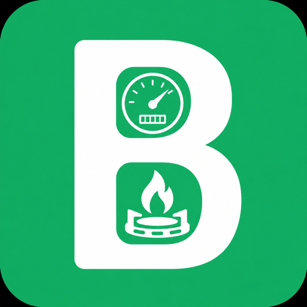

# BillBoard

[Visit the BillBoard website](https://akifislam.github.io/nesco-android-app/) · A private electricity and gas dashboard for NESCO, DESCO, and PGCL. Track balances, payments, and low-balance alerts in one clear view.

<p align="center"></p>
<h3 align="center">Every meter. One calm view.</h3>
<p align="center">A private multi-meter dashboard for NESCO, DESCO, and PGCL.<br>No account. No login. Your saved connections stay on your device.</p>

<p align="center">
  <a href="https://play.google.com/store/apps/details?id=com.butterflydevs.billboard&hl=en"></a>
  <a href="docs/downloads/BillBoard-Android-v1.0.3.apk"></a>
  <a href="docs/downloads/BillBoard-iOS-v1.0.ipa"></a>
</p>

> The iOS download is an unsigned IPA for personal sideloading. Apple requires each user to sign it with their own Apple ID using Xcode, AltStore, or Sideloadly. It cannot be installed by simply opening the file.

## What BillBoard does

BillBoard brings multiple electricity and gas connections into one focused dashboard. Instead of opening a different portal for every home, apartment, office, or family property, name each connection and check it at a glance.

- **Multi-provider dashboard:** NESCO prepaid and postpaid, DESCO prepaid, and PGCL postpaid.
- **Live utility information:** balance or due status, last recharge/payment, and provider-specific details.
- **Balance prediction:** an estimate of how many days a prepaid balance may last, based on recent usage.
- **Low-balance alerts:** local notifications when a connection needs attention.
- **Useful offline:** cached information remains visible when the network is unavailable.
- **Local-first privacy:** saved meter identifiers and nicknames remain on the device.
- **No registration:** no BillBoard account, password, or cloud profile.

## Editions and branches

| Branch | Edition | Stack |
| --- | --- | --- |
| [`main`](../../tree/main) / [`android`](../../tree/android) | Android production app | Kotlin, Jetpack Compose, DataStore, WorkManager |
| [`ios`](../../tree/ios) | Native iPhone app | Swift, SwiftUI |
| [`web`](../../tree/web) | Local web dashboard | Node.js, Express, vanilla JavaScript |

The public source and downloadable builds contain **no saved customer, meter, balance, or utility-response data**. Every installation starts empty.

## Android

Requirements: Android Studio or JDK 11+, Android SDK, and Gradle.

```bash
./gradlew :app:assembleDebug
```

The debug APK is written to `app/build/outputs/apk/debug/app-debug.apk`.

Release signing is intentionally external to this repository. Create a local `keystore.properties` file only on the build machine; it and `*.jks` / `*.keystore` files are ignored by Git. Never commit signing credentials.

## iOS

Open `BillBoard.xcodeproj` from the `ios` branch, choose your Apple development team, select a simulator or connected iPhone, and press Run. The project targets iOS 17 or later.

The direct IPA is unsigned and intended for users who understand personal signing. For broad installation, use TestFlight/App Store distribution or an Apple Developer Ad Hoc profile containing each permitted device.

## Web

```bash
cd web
npm ci
npm start
```

The server prints its local URL at startup. Saved connections are local runtime data and are excluded from the public repository.

## Privacy and security

BillBoard reads publicly available utility customer portals only when requested. The Android and iOS apps store saved connections locally. The app does not require a BillBoard account and does not include analytics or advertising SDKs.

Repository safeguards exclude:

- Android keystores and `keystore.properties`
- local SDK paths and IDE user state
- Apple provisioning profiles and signing certificates
- saved meter lists, cached customer responses, and personal screenshots
- environment files and common credential formats

## Disclaimer

BillBoard is an independent utility information tool. It is not affiliated with, operated by, or endorsed by NESCO, DESCO, or PGCL. Availability depends on the providers' public portals and may change when those portals change.

## Customized versions

Need a customized version for an apartment building, office, organization, or another utility workflow? Contact **[iamakifislam@gmail.com](mailto:iamakifislam@gmail.com)**.

---

Built by Akif Islam · A Butterfly Devs™ product
